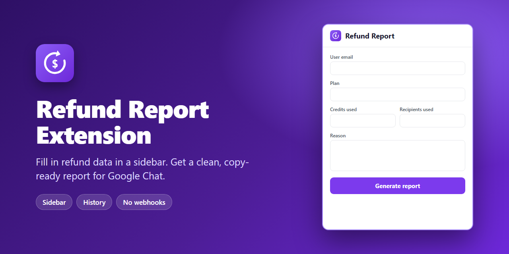

<p align="center">
  
</p>

# Refund Report Extension

A Chrome sidebar extension for Snov.io support agents. Fill in the refund / cancellation data once, in one place, and get a clean report ready to paste into Google Chat — no more switching tabs to copy customer info around.

- **No webhooks, no servers.** Everything stays in your browser. The extension makes no network requests.
- **Sidebar that stays open.** It only closes with the **X** or by clicking the extension icon again — clicking elsewhere on the page does not close it.
- **Copy-ready report.** One click opens the report next to the sidebar, with bold field names, one field per line.
- **History.** Made a mistake? Open the history, pick a past report, fix it and generate it again.

## Download and install

1. **[Download Refund-Report-Extension.zip](https://github.com/Fernandosgoes/Refund-Report-Extension-Snovio/raw/main/Refund-Report-Extension.zip)**
2. Unzip it anywhere you want to keep it (for example `Documents\Refund-Report-Extension`). **Don't delete this folder afterwards** — Chrome loads the extension from it.
3. Open `chrome://extensions` in Chrome.
4. Turn on **Developer mode** (top-right toggle).
5. Click **Load unpacked** and select the unzipped `Refund-Report-Extension` folder.
6. Click the puzzle icon in the toolbar and **pin** the extension so it's always one click away.

To update later, download the new zip, replace the folder contents and click the reload ↻ button on the extension card in `chrome://extensions`.

> Works on any normal web page. Chrome blocks extensions on `chrome://` pages and on the Chrome Web Store, so the sidebar won't open there.

## How to use

1. Open the page you're working on (Crisp, Google Chat, etc.) and click the extension icon. The sidebar opens on the right.
2. Fill in the fields, one under the other:

   | Field | Notes |
   | --- | --- |
   | User email | |
   | How long with us | e.g. `2026-01-12 18:18:41` |
   | Plan | Dropdown with all paid plans |
   | Charge date | e.g. `13 Oct 2026 - 11 Jan 2027` |
   | Amount | Numbers only; the `$` is added in the report |
   | Credits used / Recipients used / Warm-up used / Slots used | Numbers only (dots and commas allowed) |
   | Reason | Free text |
   | What was offered to prevent refund/cancellation | Free text |
   | How did the customer respond | Free text |
   | Form filled out | Yes / No |
   | Chat link | |

3. Click **Generate report**. The report opens in a panel next to the sidebar and the form resets, ready for the next customer.
4. Click **Copy report** and paste it into Google Chat. Field names keep their **bold** formatting; Google Chat usually preserves it, but plain-text fields won't show it.

### Report format

```
User email: alan@example.com
How long with us: 2026-01-12 18:18:41
Plan: Pro S 3 Months Plan
Charge date: 13 Oct 2026 - 11 Jan 2027
Amount: $268.04
Credits used: 0
Recipients used: 0
Warm-up used: 1
Slots used: 0

Reason: Unwanted renewal

What was offered to prevent refund/cancellation:
A discount coupon and a call.

How did the customer respond:
Rejected both and kept insisting on a full refund.

Form filled out: Yes

Chat link: https://app.crisp.chat/website/...
```

### History

Click the clock icon next to **Refund Report** to see every report you've generated (newest first, up to 100). Click one to load all its fields back into the form, edit what you need and generate again — the entry is updated instead of duplicated. Use **×** to delete a single entry or **Delete all** to clear the list.

## Privacy

Drafts and history are stored with `chrome.storage.local`, on your own machine only. Nothing is sent anywhere. Permissions used: `storage` (drafts and history), `activeTab` and `scripting` (to show the sidebar on the current page).

## Project structure

```
manifest.json     Extension manifest (Manifest V3)
background.js     Opens/closes the sidebar and report panels on the page
popup.html/js/css The sidebar: form, plan dropdown, history
report.html/js/css The report panel with the copy button
icons/            Extension icons
```

## Customizing

- **Plans:** edit the `PLANS` list at the top of `popup.js`.
- **Fields / report layout:** edit `FIELDS` in `popup.js` and the matching inputs in `popup.html`.

After any change, reload the extension in `chrome://extensions`.
